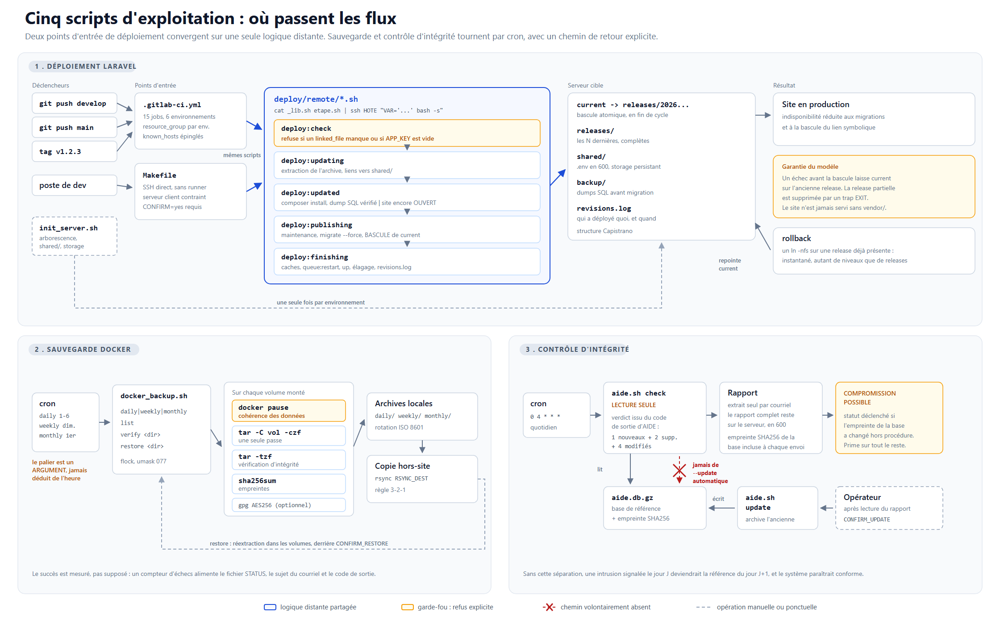

# Ops toolkit - déploiement et supervision sur hébergement contraint

[](https://gitlab.com/windy6191/shared-hosting-ops/-/pipelines)

Outils d'exploitation pour des environnements où les solutions habituelles ne
sont pas disponibles : mutualisés cPanel ou AmenPanel, serveurs clients sans
runner CI, VPS sans orchestrateur. Pas de Kubernetes, pas de Ruby, pas de CI
managée - seulement SSH, `make`, `bash` et ce que l'hébergeur veut bien fournir.

| Outil | Rôle |
|---|---|
| [`recipes/laravel/`](recipes/laravel/) | Déploiement Laravel sans interruption, modèle Capistrano, par pipeline GitLab **ou** par Makefile |
| [`docker-backup/`](docker-backup/) | Sauvegarde de volumes Docker, vérifiée, chiffrable, restaurable |
| [`aide/`](aide/) | Contrôle d'intégrité AIDE avec cycle de vie explicite de la base de référence |



---

## Le fil conducteur : l'échec silencieux

Ces outils sont issus de scripts d'exploitation réels, remis à plat. Le
diagnostic initial a fait ressortir un défaut unique, décliné neuf fois :
**le système annonçait un succès qu'il n'avait pas vérifié.**

| Où | Ce qui se passait |
|---|---|
| Pipeline | `allow_failure: true` sur le build front → un front cassé partait en production |
| Pipeline | `artisan migrate` sans `--force` → migrations annulées sans bruit hors TTY |
| Pipeline | « Déploiement réussi » affiché sans jamais interroger le site |
| Pipeline | Rollback restaurant le code mais jamais la base → faux filet de sécurité |
| Makefile | `test -s` sur un gzip vide (20 octets) → un dump SQL vide passait pour valide |
| Docker | `$?` testait la fonction de log, pas `docker save` → sauvegarde ratée annoncée réussie |
| Docker | Rotation triant `%d-%m-%Y` en lexicographique → suppression de la mauvaise sauvegarde |
| AIDE | `--check` suivi de `--update` → une intrusion devenait la référence du lendemain |
| Init | `ln -s` vers une cible absente réussit → configuration PHP jamais appliquée |

Chacun est désormais fermé, et la plupart sont couverts par un test.
Le principe retenu : **mieux vaut un cron bruyant qu'un cron silencieux.**
Lancés sans argument, les scripts sortent en erreur plutôt que d'afficher
l'aide - une crontab mal reprise doit se voir.

---

## Conformité au modèle Capistrano

`recipes/laravel/` implémente la structure de référence
([documentation](https://capistranorb.com/documentation/getting-started/structure/)).
Les écarts sont assumés et documentés, pas subis :

| Élément | État | Motif |
|---|---|---|
| `releases/<horodatage>/` | conforme | - |
| `current -> releases/<...>` | conforme | Bascule atomique en **fin** de déploiement |
| `shared/` (`linked_files`, `linked_dirs`) | conforme | Correspondance explicite dans `_lib.sh` |
| `revisions.log` | conforme | Horodatage, action, révision, auteur |
| `repo/` | **écart assumé** | Le CI livre un artefact ; le serveur n'a ni git ni accès au dépôt |
| `shared/` à plat | **écart assumé** | Hérité des serveurs en place, plutôt que de refléter l'arborescence |

La garantie centrale du modèle est respectée :

> *« If the deployment fails in any step the `current` symlink still points to
> the old release. »*

Tout ce qui est long (transfert, `composer install`, dump SQL) s'exécute site
ouvert. Seules les migrations et la bascule se déroulent en maintenance.

---

## Une logique distante, deux points d'entrée

Le pipeline GitLab et le Makefile partagent **les mêmes scripts** dans
`recipes/laravel/deploy/remote/`, envoyés au serveur par `ssh 'bash -s'` :

```
cat deploy/remote/_lib.sh deploy/remote/deploy.sh \
  | ssh $HOST "PROJECT_DIR='...' RELEASE_NAME='...' bash -s"
```

Deux conséquences. Les paramètres passent par variables d'environnement, ce qui
supprime l'empilement d'échappements (`\$(basename \$OLD_RELEASE_DIR)`) qui
rendait ces blocs illisibles. Et surtout, les deux chemins de déploiement ne
peuvent plus diverger - ce qu'ils faisaient : `migrate --force` était présent
d'un côté, absent de l'autre.

---

## Qualité

Trois portes bloquantes, aucune en `continue-on-error` :

```
ShellCheck --severity=style    13 scripts, niveau le plus strict
yamllint --strict              pipeline + workflows
bats                           33 tests unitaires
```

Les tests visent précisément les endroits où se trouvaient les bugs : tri
chronologique des rotations, décodage des codes de sortie d'AIDE, sélection de
la release de rollback, protection de la release active pendant l'élagage.

```bash
shellcheck --severity=style $(find . -name '*.sh')
yamllint --strict .
bats tests/
```

`tests/deploy_lib.bats` exige des liens symboliques natifs : il est
automatiquement sauté sur les plateformes qui ne les fournissent pas.

---

## Arborescence

```
recipes/                 une recette de déploiement par techno
├── README.md            index des technos
└── laravel/             miroir de ce qu'on dépose dans le projet Laravel
    ├── .gitlab-ci.yml
    ├── Makefile
    ├── config.mk.example
    ├── init_server.sh
    └── deploy/remote/       logique distante partagée
        └── make/            scripts du Makefile seul
docker-backup/           outil serveur, pas une recette
aide/                    outil serveur, pas une recette
tests/                   suites bats
```

---

## Configuration

Aucune donnée d'infrastructure n'est versionnée. Chaque outil lit un fichier de
configuration local, ignoré par git, dont seul le modèle `*.example` est suivi :

```bash
cp recipes/laravel/config.mk.example        recipes/laravel/config.mk
cp docker-backup/docker-backup.conf.example /etc/docker-backup.conf
cp aide/aide-report.conf.example            /etc/aide-report.conf
chmod 600 /etc/docker-backup.conf /etc/aide-report.conf
```

---

## Licence

[MIT](LICENSE).
